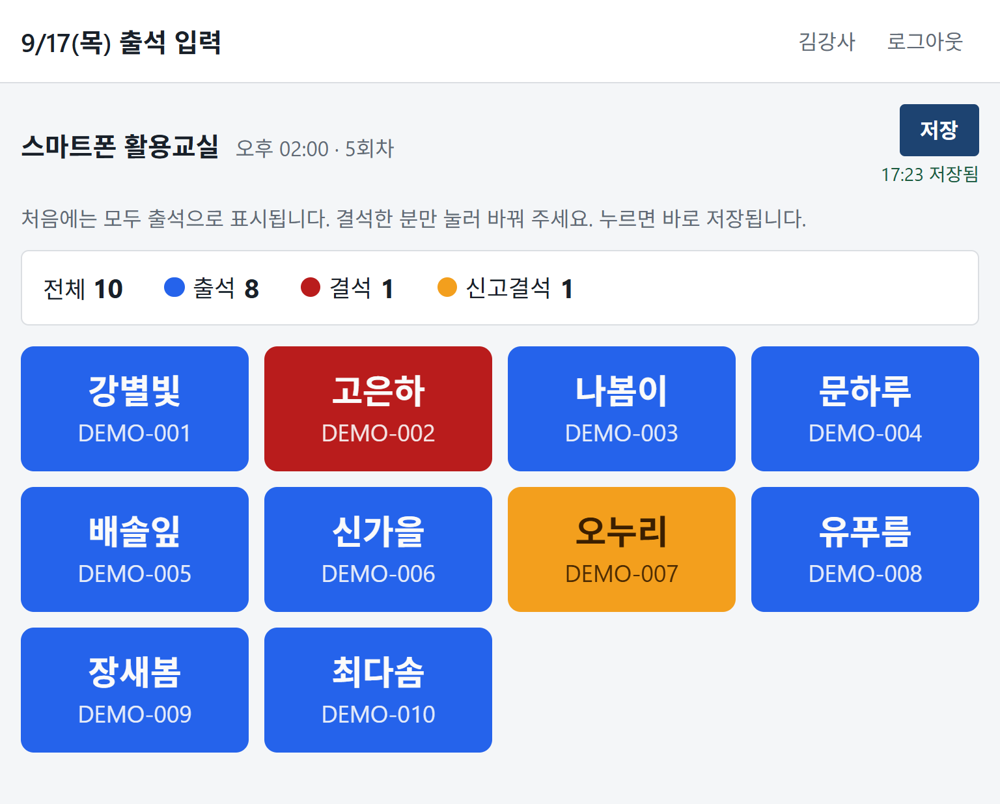
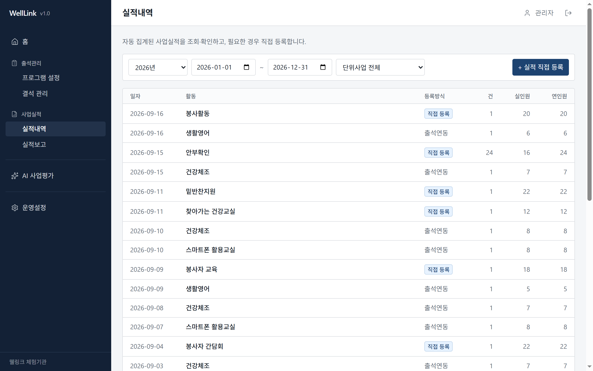
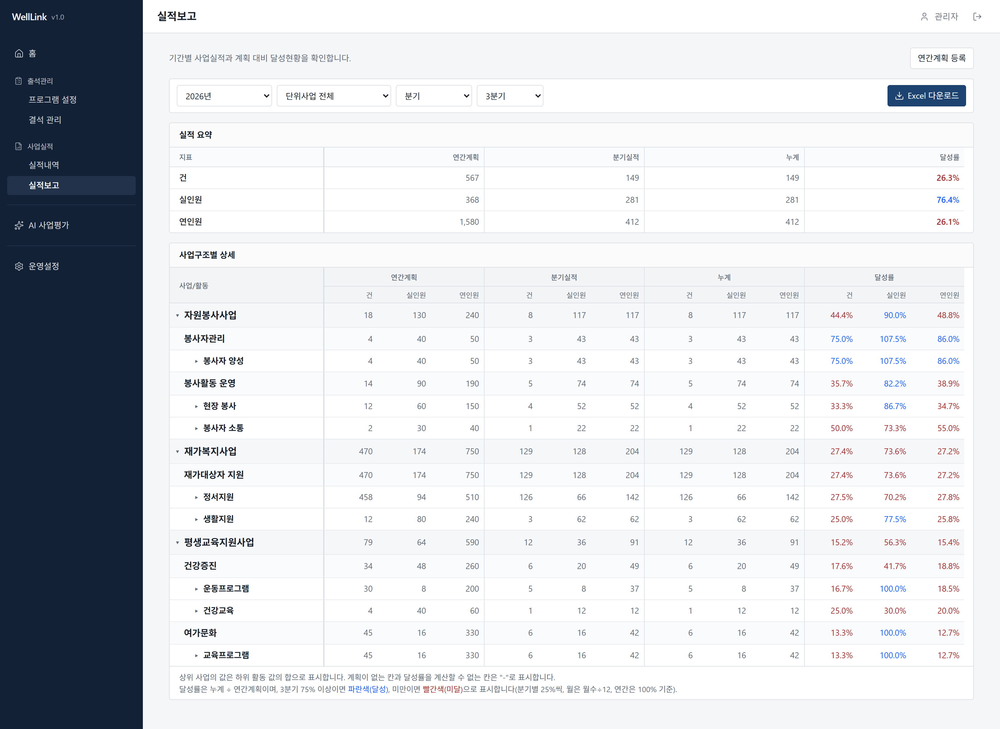
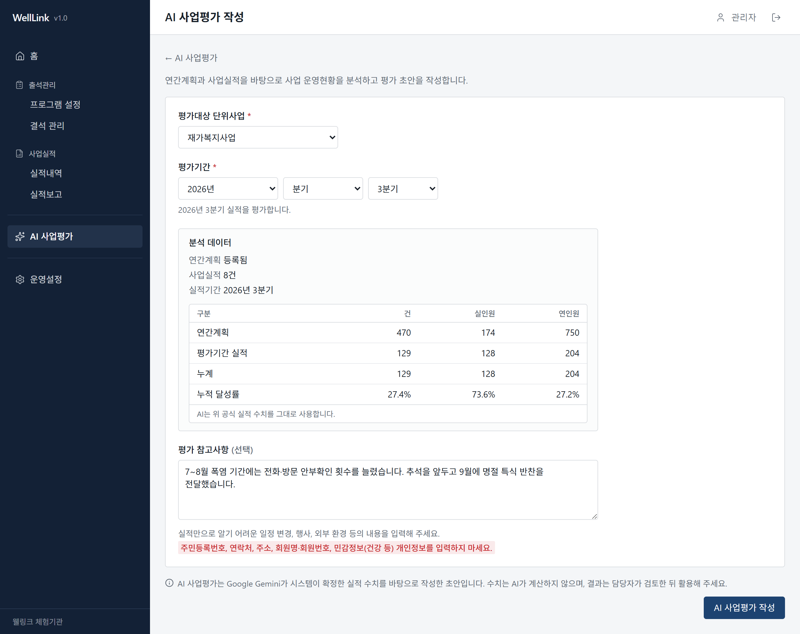
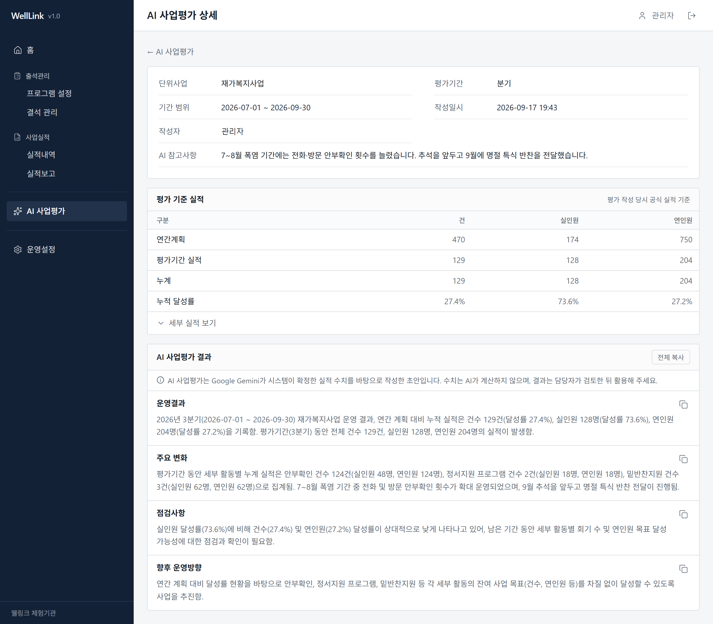

# **WellLink (웰링크)**

**한 번 기록한 출석·운영데이터를 다시 입력하지 않고 실적·보고·평가까지 연결하는 AI 기반 복지관 업무지원 솔루션**

## **📌 이 저장소의 버전과 운영 서비스 적용 상태 (2026-11-05 기준)**

이 저장소의 소스에는 **운영 서비스에 아직 적용하지 않은 변경**이 들어 있습니다. 아래 표로 구분해서 읽어 주세요.

| 항목 | 현재 운영 서비스(역삼노인복지관 등) | 이 저장소의 소스 |
| --- | --- | --- |
| 마이그레이션(데이터베이스 변경 파일) | **75개 적용**(마지막 `20261104020000`) | **77개**(운영에 없는 `20261105010000`, `20261105020000` 2개 추가) |
| 강사 최초 인증 | 휴대전화 뒤 4자리로 로그인한 뒤 6자리 PIN을 만듭니다. 이 방식에는 **아직 PIN을 만들지 않은 계정을 다른 사람이 먼저 차지할 수 있는 한계**가 있습니다. | 관리자가 발급한 **일회용 6자리 시작코드**로 최초 인증합니다(아래 4.6절 5번). |
| 상태 | 운영 중 | **개발·시험 완료 — 운영 미반영** |

- 시작코드 기능은 운영 서비스와 분리된 **별도의 시험용 Supabase 프로젝트**에서 시험했습니다(발급·최초 로그인·PIN 설정·재발급·만료·잠금·다른 기관 차단·세션 종료·출석 입력부터 실적보고 반영까지). **운영 서비스에서 동작한다는 뜻이 아닙니다.**
- 이 소스를 새 Supabase 프로젝트에 설치하면 마이그레이션 77개가 모두 적용되어 시작코드 방식으로 동작합니다.
- **이미 운영 중인 데이터베이스에 시작코드를 적용하려면** 순서가 중요합니다. [마이그레이션 적용 순서와 버전 차이](#마이그레이션-적용-순서와-버전-차이)를 반드시 따르세요.
- 운영 서비스에 적용하면 이 안내를 "운영 적용 완료(날짜)"로 바꾸고, 그때까지는 위 표를 그대로 유지합니다.

## **⚠️ 다른 기관이 도입하기 전에 꼭 확인해 주세요**

WellLink는 이용자의 성명·회원번호·출결 기록을 다룹니다. 도입 전에 아래 항목을 먼저 확인해 주세요. 자세한 내용은 각 항목의 연결 절을 참고하세요.

| # | 도입 전 확인 사항 | 자세한 내용 |
| --- | --- | --- |
| 1 | **처리방침·동의 확인** — WellLink에는 처리방침 게시나 동의 확인 기능이 없습니다. 기관의 기존 개인정보 수집·이용 동의서가 WellLink의 처리(성명·회원번호·출결 기록의 클라우드 보관, 직원·강사 계정 정보)를 포함하는지 확인하고, 처리방침은 기관이 별도로 게시해야 합니다. | [4.5](#45-개인정보ai-윤리-항목), [4.6](#46-도입-기관-유의사항-및-알려진-한계) |
| 2 | **국외 이전·위탁 확인** — 데이터는 도입 기관이 만든 Supabase 프로젝트에 저장되고, AI 사업평가를 쓰면 Google Gemini API로 일부 정보가 전송됩니다. Supabase 프로젝트 지역과 Google의 이용 약관(요금제별 입력 데이터 학습 사용 여부 포함)을 확인하고, 필요한 위탁·국외 이전 고지를 기관이 수행해야 합니다. | [4.6](#46-도입-기관-유의사항-및-알려진-한계) |
| 3 | **강사 최초 인증** — 이 저장소의 소스는 관리자가 발급한 **6자리 일회용 시작코드**로 강사의 최초 인증을 합니다(7일 안에 한 번만 사용, 재발급하면 이전 코드는 무효, 로그인 화면의 PIN 칸에 입력하고 이어서 6자리 PIN을 만듭니다). **이 방식은 개발·시험 완료 상태이며 운영 서비스에는 아직 적용되지 않았습니다.** 시작코드는 강사 본인에게 직접 전달하세요. 가능하면 강사 로그인 목록 노출을 끄세요(화면 설정은 없으며, 4.6절 5번의 SQL 한 줄로 끕니다). | [4.6](#46-도입-기관-유의사항-및-알려진-한계) |
| 4 | **직원 비밀번호·MFA** — Supabase Auth 설정에서 비밀번호 최소 길이를 높이고 MFA(다단계 인증)를 켜세요. | [4.6](#46-도입-기관-유의사항-및-알려진-한계) |
| 5 | **보안 업데이트** — 배포 전과 이후 월 1회 `bun audit`로 알려진 보안 결함을 확인하고, `@tanstack/react-start` 등 의존성을 최신 보안 수정판으로 유지하세요. | [4.2](#42-외부-자료-및-오픈소스-사용-내역), [4.6](#46-도입-기관-유의사항-및-알려진-한계) |
| 6 | **보존·파기 운영 규칙** — 자동 파기 기능이 없습니다. 종결·퇴직 후 보존 기간은 기관이 정하고, 기간이 지난 정보는 Supabase에서 직접 지우거나 비식별로 바꿔야 합니다. | [4.6](#46-도입-기관-유의사항-및-알려진-한계) |
| 7 | **Gemini 사용 한도 설정** — Google 계정(Google AI Studio·Google Cloud)에서 월 사용 한도 또는 예산 알림을 설정해 예상하지 못한 비용을 막으세요. | [3️⃣ 설치 및 실행 방법](#소스코드-직접-실행) |

※ 이 문서는 법률 자문이 아닙니다. 개인정보 보호 관련 법령과 기관 내부 규정에 대한 판단은 기관이 법률 검토를 받아 진행해 주세요.

## **1. 팀 기본 정보**
### **1.1 기관 정보**

**역삼노인복지관**은 강남구립 노인여가복지시설로, 지역 어르신의 활기 있고 품위 있는 노후생활을 지원하기 위해 평생교육, 건강증진, 정서지원, 급식, 지역복지, 세대통합, 사회참여 프로그램을 운영하고 있습니다.
특히 평생교육 프로그램의 비중이 높아 출석·참여기록, 실적관리, 분기별 사업평가가 주요 운영업무이며, 2026년에는 직원 디지털 역량강화와 AI 기반 업무효율화를 기관 차원에서 추진하고 있습니다.

### **1.2 팀 구성원 정보**

| 구분  | 이름 | 소속·직책 | AI 챌린지 해에서의 담당 역할 |
| --- | ------ | --------- | --------------------- |
| 팀장 | 이상진 | 역삼노인복지관 관장 | 팀 대표, 기관 운영 전반의 문제 정의·의사결정·대외협력, 현장 적용 가능성 검토 |
| 팀원 | 김새봄 | 역삼노인복지관 과장 | 행정·회계·문서관리, 실적보고, 내부 결재체계 관점에서 운영 적합성 검토 |
| 팀원 | 김슬기 | 역삼노인복지관 팀장 | 현장업무 분석, 제품 기획, AI 도구를 활용한 개발 지휘, 실데이터 반영·검증, 화면 점검, 현장 적용 |
| 팀원 | 송은송 | 역삼노인복지관 사회복지사 | 실제 프로그램 담당자 관점에서 출석 확인·실적집계·사업평가 등 반복업무와 개선 필요사항 검증 |

## **2. AI 솔루션**

### **2.1 문제 정의**
복지관에서는 프로그램을 운영하며 참여인원, 운영횟수, 출결, 목표 달성률 등 다양한 데이터가 계속 쌓입니다. 하지만 이 정보들은 종이, Excel, 시스템, 업무일지 등에 나뉘어 관리되어 한 번 입력한 내용을 다음 업무에 그대로 활용하기 어렵습니다.

본 기관의 노년사회화교육사업도 학기별 29개 프로그램과 연중 프로그램 1개를 운영하며, 2026년 상반기에만 이용자 311명, 수업 615회의 운영데이터가 발생했습니다.
문제는 데이터가 없는 것이 아니라, 이미 만들어진 데이터가 서로 연결되지 않는 것이었습니다.

| 업무 | 기존 방식의 문제 |
| --- | --- |
| 운영기록 | 출결·참여정보가 여러 곳에 분산되어 저장됨(출석부, RF기록, 일지 등) |
| 실적관리 | 참여인원과 운영횟수를 다시 확인하고 계산함 |
| 보고 | 같은 데이터를 월·분기 자료에 다시 입력함 |
| 평가 | 계획과 실적을 별도로 찾아 비교하고 평가문을 작성함 |

- 담당 직원 인터뷰에서도 매일 자료 정리에 약 5~10분, 월 실적 마감에 약 2시간, 분기 실적 확인에 약 30분이 소요되는 것으로 확인되었습니다.

  즉, 핵심 문제는 업무 단계마다 같은 데이터를 반복해서 찾고, 계산하고, 다시 입력해야 한다는 것​입니다.

- WellLink는 한 번 생성된 운영데이터가 기록 → 실적 → 보고 → 평가로 이어지도록 연결하여 반복 업무를 줄이는 것을 목표로 합니다.

- 주요 사용자는 복지관 직원과 강사이며, 이용자가 직접 사용하는 서비스가 아닌 복지관 업무를 지원하는 시스템입니다.

### **2.2 AI 솔루션 소개**
#### **1️⃣ 솔루션 개요**
WellLink는 복지관에서 발생하는 프로그램 운영데이터를 한곳에 모아 기록 → 관리 → 실적 → 보고 → 평가까지 연결하는 업무지원 시스템입니다.

핵심 원칙은 “같은 정보를 두 번 입력하지 않는다”​입니다.

- 운영정보를 한 번 기록합니다.
- 출석, 결석, 프로그램 운영결과 등 현장에서 발생한 정보를 시스템에 기록하고 한곳에서 관리합니다.
- 기록된 데이터를 실적과 보고에 다시 활용합니다.
- 시스템이 참여인원, 운영횟수 등 필요한 실적을 자동으로 계산하고 월·분기·연간 단위로 집계합니다. 출석관리가 필요하지 않은 사업도 실적을 직접 등록해 같은 체계에서 관리할 수 있습니다.
- 계획과 실제 운영결과를 바로 비교합니다.
- 연간계획과 누적 실적을 연결해 목표 달성률을 자동으로 확인할 수 있어, 보고 시 여러 자료를 다시 찾아 계산하는 과정을 줄였습니다.
- 쌓인 데이터를 AI가 평가 초안으로 정리합니다.
- Google Gemini는 시스템에 저장된 연간계획과 확정 실적을 바탕으로 사업평가 초안을 작성합니다. 실적과 달성률 계산은 시스템이 담당하고, AI는 확정된 데이터를 문장으로 정리하는 역할만 합니다.

즉, WellLink는 각각 떨어져 있던 업무를 하나의 흐름으로 연결해 현장에서 한 번 만든 데이터를 이후 업무에서도 계속 활용할 수 있도록 설계했습니다.

#### **2️⃣ 솔루션 사용 링크**

| 구분        | 링크 또는 안내                  |
| -------------- | ----------------------------- |
| 솔루션 실행 링크      | 직원: https://welllink.lovable.app <br> 강사: https://welllink.lovable.app/instructor/login |
| 소스코드 또는 결과물 원본 | [📂 이 저장소의 최상위 폴더가 곧 소스코드입니다](./) (압축하지 않은 파일, `package.json`이 최상위에 있습니다) |
| 데모 영상 | [▶ WellLink 데모 영상 보기](WellLink_Final_Demo.mp4) |
| 테스트 계정<br>(웰링크 체험기관)     | 관리자 ID: admin@example.com&nbsp;&nbsp;&nbsp;&nbsp;PW: test1234! <br> 직원 ID: staff@example.com&nbsp;&nbsp;&nbsp;&nbsp;PW: staff1234! <br> 강사 ID: 김강사0001&nbsp;&nbsp;&nbsp;&nbsp;PIN: 001234 |

##### **체험 계정 운영 안내**

WellLink 체험 계정은 오픈소스 공개 및 초기 설치·기능 검증을 위해 한시적으로 제공되며, 검증 완료 이후 접근이 차단되고 계정이 정리될 예정입니다. 종료 일정은 아직 확정되지 않았으며, 체험 데이터의 장기 보관은 보장하지 않습니다.

- **종료 일정**: 종료 일정은 확정되지 않았으며, 체험 계정은 **별도 공지 없이 종료**될 수 있습니다.
- **자료 보관**: 체험 계정에 입력한 자료는 장기 보관을 보장하지 않으며, 미리 알리지 않고 초기화되거나 삭제될 수 있습니다.
- **AI 사업평가 사용량**: 체험 서비스의 AI 사업평가는 Gemini **무료 요금제**를 사용하므로 사용량 제한(분당·일일 요청 한도)이 있습니다. 사용이 몰리면 "AI 사업평가 작성에 실패했습니다" 오류가 날 수 있으며, 잠시 후 다시 시도해 주세요.
- **가상 계정·가상 데이터**: 테스트 계정은 체험용 가상 계정이며, 조회되는 DB 데이터도 모두 데모용 가상 데이터입니다. 실제 운영기관의 개인정보·업무데이터와는 기관별 접근제어(RLS)로 분리되어 있습니다.
- **입력 금지**: 이 계정은 **공개되어 누구나 쓸 수 있으므로 실제 이용자 정보나 개인정보를 입력하지 마세요.** 비밀번호를 바꾸거나 계정을 추가하면 다른 체험자가 로그인하지 못할 수 있으니 변경하지 마시고, AI 사업평가는 기능 확인에 필요한 만큼만 사용해 주세요.
- **실제 기관의 사용**: 실제 기관에서 WellLink를 사용하려는 경우에는 공개된 소스코드를 이용하여 **별도의 독립된 Supabase 환경에 설치**해야 합니다([소스코드 직접 실행](#소스코드-직접-실행)). 체험 계정과 이 서비스 링크는 실제 업무 용도로 사용할 수 없습니다.
- 이 계정은 운영 서비스에만 있고, 소스를 직접 설치한 환경에는 만들어지지 않습니다.

#### **3️⃣ 설치 및 실행 방법**

- 기능 확인(체험)은 별도 설치 없이 서비스 링크에서 바로 할 수 있습니다. 다만 체험 계정은 임시로 제공되며 종료될 수 있습니다(위 "체험 계정 운영 안내" 참고).
- 실제 기관이 사용하려면 이 저장소의 소스로 **별도의 독립된 Supabase 환경에 설치**해야 합니다. 직접 설치한 환경에서는 공급자가 발급한 1회용 초대코드(14일 유효)로 다른 기관이 가입해 첫 관리자 계정을 만드는 기능을 쓸 수 있습니다.
- API 키·비밀번호·인증 토큰 등 실제 운영 계정정보는 GitHub 저장소에 포함하지 않습니다.

#### 소스코드 직접 실행

이 저장소의 최상위 폴더가 소스코드입니다(`git clone` 또는 GitHub의 코드 내려받기로 가져옵니다). 직접 실행에는 **Bun 1.3.14 이상(개발은 1.3.14에서 진행했고, 1.4.4에서도 설치·빌드가 확인됨), Supabase 프로젝트, Google Gemini API 키**가 필요합니다. 서버는 Cloudflare Worker 형태로 빌드되며, 빌드 도구 nitro는 베타 버전(`3.0.260603-beta`)을 사용하므로 정식판이 나오면 올릴 예정입니다.  
제출본의 UI 개발 및 서비스 배포에는 Lovable을 사용했습니다.

> ✅ **빈 Supabase 프로젝트에서도 설치할 수 있도록 고쳤습니다(2026-11-04, 당시 마이그레이션 75개 기준).** 3번째 마이그레이션(`20260906080425_business_structure_and_operation_term_correction.sql`)이 이미 있는 사업구조 데이터를 필요로 해서 빈 DB에서는 멈췄기 때문에, 데이터가 없으면 그 정정 블록을 건너뛰도록 5줄을 추가했습니다(운영 DB에는 이미 적용된 파일이라 영향이 없습니다). 격리된 Postgres(PGlite)에 마이그레이션 75개를 순서대로 적용해 본 결과 **모두 적용되었고**, 만들어진 구조(표 34개, 열 338개, 함수 117개와 함수 본문, 정책 36개, 인덱스 106개, 트리거 20개 등)가 **운영 DB와 같았습니다.** 이 시험은 `scripts/verify-fresh-install.mjs`로 다시 돌릴 수 있습니다(2026-11-05부터 마이그레이션 77개와 시작코드 흐름을 기준으로 갱신). 시작코드 2개가 더해진 **77개 구조는 시험용 Supabase 프로젝트에서 확인했고, 운영 DB와의 구조 대조는 운영에 적용한 뒤에 다시 합니다**(지금 운영 DB는 75개라 77개 구조와 다릅니다). 이어서 **실제 새 Supabase 프로젝트(무료 요금제)에서도 직접 실행**해 확인했습니다(2026-11-04). `supabase db push`로 75개가 모두 적용되었고, 결과 구조(표·열·함수 본문·정책·인덱스·트리거·제약)가 운영 DB와 **차이 없이 같았으며**, 아래 "최초 관리자 만들기" 절차와 강사 PIN 흐름(처음 PIN → 6자리 새 PIN → 로그인)도 그대로 동작했습니다. 이 확인은 개발 기관이 한 번 수행한 것이므로, 설치 중 문제가 생기면 이 저장소의 Issues로 알려 주세요. 실제 기관은 체험 서비스가 아니라 이 소스로 만든 독립된 Supabase 환경에 설치해야 합니다.

| 단계 | 실행 방법 |
| --- | --- |
| 1. 의존성 설치 | `bun install` |
| 2. Supabase CLI 로그인 | `npx supabase login` |
| 3. Supabase 프로젝트 연결 | `npx supabase link --project-ref <PROJECT_REF>` — **본인이 만든 프로젝트의 값**을 넣으세요. 저장소의 `supabase/config.toml`의 `project_id`는 로컬 개발 환경에서 쓰는 이름표(`welllink`)일 뿐 특정 Supabase 프로젝트를 가리키지 않으며, 연결 대상은 `link`가 정합니다. |
| 4. 환경변수 설정 | `.env.example`을 `.env.local`로 복사해 값을 채웁니다. 아래 **환경변수 표** 참고 |
| 5. 데이터베이스 구조 적용 | `npx supabase db push --linked` — **새 프로젝트**를 연결(`link`)한 뒤 실행하면 마이그레이션 77개가 순서대로 적용됩니다. 적용 전 `--dry-run`으로 대상 파일을 확인하세요. 이미 쓰고 있는 DB에는 아래 "마이그레이션 적용 순서"를 따르세요. |
| 6. 첫 기관·최초 관리자 만들기 | 아래 **최초 관리자 만들기** 참고 |
| 7. 개발 서버 실행 | `bun run dev` |
| 8. 빌드 | `bun run build` |
| 9. 설치 확인 | 아래 **마이그레이션 적용 확인**과 **설치 후 확인 순서** 참고 |

※ 실제 API 키, 비밀번호, 인증 토큰은 저장소에 포함하지 않으며 실행 환경에서 별도로 설정해야 합니다.

##### 환경변수

| 이름 | 종류 | 용도와 주의사항 |
| --- | --- | --- |
| `VITE_SUPABASE_URL` | 브라우저용 | Supabase 프로젝트 주소 |
| `VITE_SUPABASE_PUBLISHABLE_KEY` | 브라우저용 | Supabase 공개키(RLS로 보호되는 키). 이전 이름인 `VITE_SUPABASE_ANON_KEY`도 읽지만 새로 설정한다면 이 이름을 쓰세요. |
| `SUPABASE_SERVICE_ROLE_KEY` | **서버 전용** | 강사 로그인, 기관 생성, 직원 계정 관리에 사용합니다. **브라우저에 노출되면 안 됩니다.** 로컬에서는 `.env.local`에, 배포(Cloudflare Worker)에서는 파일이 아니라 **Worker 비밀값(secret)** 으로 등록합니다. |
| `GEMINI_API_KEY` | **서버 전용** | AI 사업평가에 사용합니다. `SUPABASE_SERVICE_ROLE_KEY`와 같은 방식으로 등록합니다. |

##### 최초 관리자 만들기

새 프로젝트에서는 마이그레이션을 적용해도 **기관과 관리자 계정이 비어 있습니다.** 마이그레이션은 기관을 만들어 주지 않으므로, 아래 순서로 직접 만듭니다.

1. Supabase 대시보드의 SQL Editor에서 **첫 기관을 만들고 공급자 기관으로 지정**합니다. `<기관명>`과 `<기관코드>`(영문 소문자·숫자·하이픈, 3~32자)는 기관에 맞게 바꾸세요. **기관 ID는 아래 값 그대로 입력해야** 다음 단계의 스크립트가 동작합니다.

   ```sql
   insert into public.organizations (id, name, org_code)
   values ('00000000-0000-0000-0000-000000000001', '<기관명>', '<기관코드>');

   update public.organizations
   set is_supplier = true
   where id = '00000000-0000-0000-0000-000000000001';
   ```

2. `.env.local`에 `VITE_SUPABASE_URL`과 `SUPABASE_SERVICE_ROLE_KEY`를 채운 뒤, **본인 터미널에서** 최초 관리자를 만듭니다. 이름과 이메일을 입력하면 임시 비밀번호가 화면에 출력됩니다(최초 1회만 쓰며, 이미 관리자가 있으면 중단됩니다). 질문에는 **터미널에서 직접 입력**하세요. 입력을 붙여넣기나 파이프로 한 번에 넣으면 두 번째 질문이 건너뛰어져 아무것도 만들어지지 않고 끝날 수 있습니다.

   ```bash
   bun run scripts/bootstrap-first-admin.ts
   ```

3. `bun run dev` 후 `http://localhost:8080/login`에서 이메일과 임시 비밀번호로 로그인하면 비밀번호 변경 화면이 나옵니다.
4. 이후 직원·강사 계정은 이 관리자로 로그인해 **[설정 > 사용자 관리]** 에서 만듭니다.

##### 공급자 기관과 초대코드

- **공급자 기관**은 다른 기관이 WellLink에 가입할 수 있도록 초대코드를 발급하는 기관입니다. 데이터베이스에서 `organizations.is_supplier = true`인 기관이며(운영 DB에서는 마이그레이션 `20260910080000`이 기관 ID `...0001`을 지정했고, 새 설치에서는 위 SQL로 지정합니다), 그 기관의 관리자만 코드를 발급·취소할 수 있습니다.
- 공급자 관리자는 **[운영설정 > 기관 초기등록]** 에서 기관별 **1회용 초대코드**(14일 유효, 사용하면 소멸)를 발급합니다. 다른 기관 담당자는 `/provision` 화면에서 이 코드로 자기 기관과 첫 관리자 계정을 만듭니다. 이 기능은 **직접 설치한 환경**에서 쓰는 것이며, 임시로 제공되는 체험 서비스는 실제 기관의 가입 용도가 아닙니다.

##### 마이그레이션 적용 순서와 버전 차이

| 환경 | 마이그레이션 | 강사 최초 인증 | 상태 |
| --- | --- | --- | --- |
| 개발 기관의 운영 서비스 | 75개 (마지막 `20261104020000`) | 휴대전화 뒤 4자리 → 6자리 PIN 만들기 | 운영 중 |
| 시험용 Supabase 프로젝트 | 77개 (마지막 `20261105020000`) | 일회용 시작코드 | 시험 완료(운영 아님) |
| 이 저장소의 소스 | 77개 | 일회용 시작코드 | 개발·시험 완료, **운영 미반영** |

**1) 새 프로젝트에 설치하는 경우**: 77개를 `db push` 한 번에 순서대로 적용하면 됩니다. 강사는 처음부터 시작코드 방식으로 만들어집니다.

**2) 이미 쓰고 있는 DB(75개 상태)를 올리는 경우 — 아래 순서를 지키세요.**

1. `supabase/migrations/20261105010000_instructor_start_code_add.sql`만 먼저 적용합니다. 열 1개와 새 함수 3개를 **더하기만** 하므로 기존 앱과 로그인은 그대로 동작합니다.
2. 새 앱 코드(이 저장소의 소스)를 배포합니다. 배포 전에 2번째 파일을 적용하면 옛 화면의 "강사 추가"가 시작코드를 보여 주지 못합니다.
3. 아직 PIN을 만들지 않은 **모든 활성 강사에게 시작코드를 발급해 직접 전달**합니다(관리자 화면, 한 명씩).
4. 강사들이 PIN을 만든 것을 확인한 뒤 `supabase/migrations/20261105020000_instructor_start_code_enforce.sql`을 적용합니다. 이 파일을 적용하면 **휴대전화 뒤 4자리로 PIN을 만드는 옛 방식이 완전히 닫힙니다.** 코드를 받지 못한 강사는 "시작코드를 쓸 수 없습니다"라는 안내가 나오고, 관리자가 재발급하면 됩니다.

**되돌리는 방법**: `supabase/rollback/` 폴더의 `20261105020000_…rollback.sql`을 먼저, 그다음 `20261105010000_…rollback.sql`을 적용합니다(순서를 어기면 스스로 중단합니다). **어느 쪽을 되돌려도 휴대전화 뒤 4자리로 최초 PIN을 만드는 옛 방식은 다시 열리지 않습니다.** 2번째 파일을 적용한 뒤에는 앱을 옛 버전으로 되돌리지 마세요(옛 앱에는 시작코드 발급 화면이 없어 강사 등록과 초기화를 할 수 없습니다). 문제가 생기면 새 버전을 고쳐 다시 배포하세요.

##### 마이그레이션 적용 확인

마이그레이션을 적용한 Supabase 프로젝트에서, 대시보드의 SQL Editor로 확인합니다.

```sql
-- 적용된 마이그레이션 개수: 새로 설치했다면 77이면 정상 (시작코드 적용 전의 기존 운영 DB는 75)
select count(*) from supabase_migrations.schema_migrations;

-- public 테이블 개수: 34이면 정상
select count(*) from pg_tables where schemaname = 'public';

-- RLS(행 단위 보안)가 꺼진 테이블: 결과가 0행이어야 정상
select tablename from pg_tables where schemaname = 'public' and not rowsecurity;
```

##### 설치 후 확인 순서

설치한 뒤 기능이 정상인지 아래 순서로 직접 확인하세요. 이 저장소에는 자동 테스트 코드가 없어 화면에서 확인하는 방법이 기본입니다.

1. 관리자 로그인 (임시 비밀번호 변경까지)
2. 사업구조 등록 (운영설정)
3. 강사 계정 생성 ([설정 > 사용자 관리])
4. 강사 로그인(`/instructor/login`) 후 출석 입력
5. 실적보고 화면에서 입력한 출석이 실적으로 집계되는지 확인
6. AI 사업평가 작성 (Gemini API 키 필요)

##### AI 모델과 Gemini 설정

- AI 사업평가는 **Google Gemini API `gemini-3.6-flash` 모델**을 사용합니다. 모델 이름과 API 주소는 환경변수가 아니라 코드(`src/lib/ai-evaluation-server.ts`의 `GEMINI_ENDPOINT`, `GEMINI_MODEL` 두 줄)에 적혀 있습니다. 따라서 API 키만 넣으면 되는 것이 아니라 **사용하는 Google 계정에 이 모델에 대한 접근 권한이 있어야** 합니다.
- 이 API 주소는 베타(`v1beta`)입니다. 공급사가 모델이나 베타 API를 종료하면 AI 평가가 멈추므로, **분기마다 Google의 모델 안내를 확인**하고 필요하면 위 두 줄을 바꾸세요.
- 예상하지 못한 비용을 막기 위해 Google 계정에서 월 사용 한도 또는 예산 알림을 설정하세요.

#### **4️⃣ 주요 기능**
| 업무         | 주요기능                  | 경감 업무 |
| -------------- | ----------------------------- | --- |
| 홈(대시보드) | 오늘의 프로그램, 입력 누락, 확인이 필요한 항목 표시 | 담당자가 전체 자료를 일일이 확인하는 업무 |
| 운영기록 | 강사의 모바일·태블릿 입력, 직원의 누락·정정 및 회차 관리 | 종이·시스템에 같은 내용을 중복 기록하는 업무 |
| 결석관리 | 신고결석, 결석 누계, 기준 임박·도달 대상 확인 | 메신저·종이에 흩어진 정보를 다시 찾는 업무 |
| 사업실적 | 운영데이터 기반 실적 자동 생성, 출석이 없는 사업은 직접등록 | 참여인원·운영횟수 재계산 및 재입력 |
| 실적보고 | 월·분기·연간 실적 및 목표 달성률 자동 집계, Excel 다운로드 | 마감 때 여러 자료를 다시 합산하는 업무 |
| AI사업평가 | 연간계획과 공식 실적을 바탕으로 평가 초안 생성 | 계획과 실적을 다시 찾아 평가문을 처음부터 작성하는 업무 |
| 운영설정 | 사업구조, 연간계획, 운영구분, 직원·강사 계정 관리 | 기관별 운영기준을 개별적으로 관리하는 업무 |

#### **5️⃣ 주요 화면**

**① 강사 운영기록 입력** - 강사가 모바일·태블릿에서 실제 수업의 출석을 입력합니다.




**② 운영데이터와 직접등록 실적** - 출석에서 자동 생성된 실적과 직접 등록한 실적을 한 화면에서 조회합니다.




**③ 사업별 실적보고** - 연간계획과 기간별 실적, 누계 및 달성률을 자동 집계하여 확인합니다.



**④ AI 사업평가 작성** - 평가 대상과 기간을 선택하면 시스템이 연간계획과 공식 실적을 평가 기준 데이터로 제공합니다.



**⑤ AI 사업평가 결과** - AI가 공식 데이터를 바탕으로 운영결과·주요 변화·점검사항·향후 운영방향의 사업평가 초안을 작성합니다.



#### **6️⃣ AI 활용 내용**
**서비스 기능(사업평가 초안 작성)**
| 구분 | 내용 |
| --- | --- |
| 사용 모델 | Google Gemini API (`gemini-3.6-flash`) |
| 활용 데이터 | 연간계획, 공식 실적·달성률, 직원 참고사항 |
| AI의 역할 | 운영결과를 분석해 사업평가 초안 작성 |
| 결과 형식 | `운영결과 / 주요 변화 / 점검사항 / 향후 운영방향` |
| 활용 원칙 | AI 결과는 초안으로 제공하며 최종 판단과 수정은 담당자가 수행 |
- 실적과 달성률 같은 숫자는 AI가 계산하지 않습니다.  
- 시스템이 먼저 공식 데이터를 계산하고, AI는 **확정된 데이터를 사람이 읽을 수 있는 평가 문장으로 정리하는 역할**만 담당합니다.
- 자료에 없는 원인을 추측하거나, 근거 없이 전년과 비교하거나, 숫자만으로 만족도 향상 등을 판단하지 않도록 생성 기준을 설정했습니다.

**개발 과정의 AI 활용**
| 도구 | 활용 내용 |
| --- | --- |
| ChatGPT | 문제 정의, 기능 범위·개발 기준 정리, 작업 순서 및 개발용 프롬프트 작성 |
| Lovable | 화면 구성 및 서비스 배포 |
| Claude Code | 데이터베이스 구조와 업무 로직 구현, 기능 수정 및 검증 |
| Claude Code + Chrome | 실제 배포 화면을 확인하며 QA 수행 |
| Claude + Chrome | 직원·강사·관리자용 사용자 가이드 제작 |
- AI가 업무 기준을 결정한 것이 아니라, 팀이 현장의 기준과 최종 판단을 담당하고 **AI는 이를 구현·검증하는 개발 도구**로 활용했습니다.

**AI 성능 개선 시도**
##### 1. 개발 전에 작업 순서와 프롬프트를 먼저 설계했습니다.
- 개발 경험이 많지 않아 Lovable이나 Claude Code에 바로 기능 구현을 요청하기보다, 먼저 ChatGPT에 현장에서 필요한 기능을 설명하고 개발 순서와 작업 단위로 정리했습니다.
- 이후 각 단계별로 Lovable·Claude Code에 전달할 프롬프트를 작성해  **기획 → 구현 → 확인 → 다음 작업** 순서로 개발했습니다.
- 이를 통해 한 번에 너무 많은 기능을 요청하면서 생기는 누락이나 재작업을 줄였습니다.

##### 2. 기획서와 심사기준을 AI가 계속 참고하도록 연결했습니다.
- 개발이 길어질수록 AI가 이전 결정과 다른 기능을 제안하거나 이미 제외한 기능을 다시 추가하는 문제가 생길 수 있었습니다.
- 이를 방지하기 위해 **Design Lock, 상세 개발 기준서, Scope Lock, 제출 가이드, 심사기준** 등을 프로젝트 자료(소스)로 제공하고 이를 기준으로 개발하도록 했습니다.
- 기능 범위, 제외 기능, 업무용어, 개발 우선순위를 문서로 고정해  **AI가 새로운 기능을 임의로 확장하기보다 확정된 기획 안에서 작업하도록** 했습니다.

##### 3. 사용자 테스트 전에 AI로 사전 QA를 진행했습니다.
- 실제 사용자에게 테스트를 요청하기 전에 Claude Code와 브라우저를 활용해 배포된 서비스를 먼저 점검했습니다.
- 화면을 직접 확인하면서 기능 연결, 데이터 일치 여부, 버튼 동작, 화면 표시 오류 등을 점검하고 발견된 문제를 먼저 수정했습니다.
- 그 후 실제 직원과 강사가 서비스를 사용하도록 해 업무 흐름과 사용성을 다시 확인했습니다. 즉, **AI 사전 QA → 오류 수정 → 실제 사용자 QA** 순서로 검증하여 기술적인 오류를 먼저 줄이고, 사용자 테스트에서는 실제 현장 사용성에 더 집중할 수 있도록 했습니다.

### **2.3 이용자용 가이드**

WellLink는 사용자 역할에 따라 별도의 가이드를 제공합니다.

- [📘 직원용 사용자 가이드](WellLink_guide_staff.pdf)  
  프로그램 운영, 출석·결석 확인, 사업실적, 실적보고, AI 사업평가 등 직원의 전체 업무 흐름

- [📗 강사용 사용자 가이드](WellLink_guide_instructor.pdf)  
  강사 로그인, 오늘 수업 확인, 출석 입력 및 수정 방법

### **2.4 관리자용 가이드**

- [📙 관리자용 사용자 가이드](WellLink_guide_admin.pdf)  
  기관 가입, 기본정보 설정, 사업구조 등록, 직원·강사 계정 생성 등 WellLink 도입과 초기 운영 설정
  
## **3. 임팩트 계획서**

### **3.1 현장 적용 결과**

WellLink는 시연용 데이터에 머무르지 않고, **실제 기관의 운영데이터와 실제 사용자 환경에서 검증**했습니다.

| 항목 | 적용·검증 결과 |
| --- | --- |
| 실제 출석 데이터 적용 | 노년사회화교육사업 학기별 29개 + 연중 1개, 총 **30개 프로그램**<br>(상반기 11,703건 + 하반기 7~8월 3,551건 = **15,254건**) |
| 데이터 정확성 | 원본자료와 대조 결과 **불일치 0건** |
| 신고결석 데이터 | 2026년 1~8월 기록 **432건**을 조회·집계 가능한 데이터로 반영 |
| 실제 사용자 참여 | 강사 7명 + 직원 5명 = **총 12명** |
| 실제 수업 적용 | 강사 7명이 각자의 실제 수업 **7회**에서 직접 출석 입력 |
| 사업실적 | 교육사업: 실제 운영데이터를 기반으로 **출석 → 결석관리 → 실적 → 실적보고 → AI 사업평가까지 전체 흐름 검증** <br> 그 외 사업(후원 등): 직원이 **직접등록 실적 입력 → 조회 → 실적보고** 기능 테스트 |
| AI 사업평가 | 연간계획과 누적 운영데이터가 필요한 기능이므로 **실제 누적데이터가 확보된 노년사회화교육사업에서 검증** |
| 타 기관 검증 | 타 기관 1곳이 초대코드를 이용해 기관 및 첫 관리자 생성 절차 확인 |

- 강사 7명과 직원 5명, 총 12명이 현장 검증에 참여했습니다. 강사는 실제 수업에서 WellLink로 출석을 입력했고, 직원은 출석·결석관리뿐 아니라 출석관리가 필요하지 않은 사업의 직접등록 실적과 실적보고 기능까지 테스트했습니다.
- AI 사업평가는 단기간의 가상데이터가 아니라 **연간계획과 실제 누적 실적이 확보된 사업을 대상으로 검증하는 것이 적절하다고 판단해 노년사회화교육사업에서 진행**했습니다.

#### **🔹 반복업무 소요시간과 업무단계의 변화**

실제 업무 담당 직원에게 기존 업무 소요시간을 인터뷰하고, 같은 직원이 WellLink에서 월·분기 실적을 확인하고 보고자료를 내려받는 데 걸리는 시간을 직접 측정했습니다.

| 업무 | 기존 방식 | WellLink 적용 시 |
| --- | --- | --- |
| 일상 출석 정리 | 매일 약 **5~10분** 동안 전체 출석기록을 확인하고 시스템 집계 내용을 정리 | 출석이 확정되면 실적까지 자동 연결되어 전체 자료를 다시 확인·집계하지 않고 **누락·정정 등 예외만 확인** |
| 월 실적마감 | ① 출석 및 시스템 실적 집계 → ② 월실적 일지 작성 → ③ Google Sheets 재등록, 평균 약 **2시간** | 실적이 이미 집계되어 있어 **확인 후 보고자료 다운로드까지 약 20초**. 향후 월실적 일지와 별도 재입력을 보고자료 출력·다운로드로 대체 검토 |
| 분기 실적 확인 | 누적 실적을 다시 확인·대조하는 데 약 **30분** | 누적 실적이 자동 집계되어 **확인 및 보고자료 다운로드까지 약 10초**. 기관 서식에 맞는 최소한의 정리만 필요 |

※ 기존 시간은 실제 담당 직원의 평소 업무에 대한 인터뷰 값이며, WellLink의 20초·10초는 동일 직원이 로그인 후 실적 확인과 보고자료 다운로드를 직접 수행한 **실측값**입니다.

※ 현재 기존 월실적 일지와 Google Sheets 업무를 공식적으로 중단한 상태는 아닙니다. 따라서 `2시간 → 20초`, `30분 → 10초`를 전체 업무시간의 확정 감소치로 보기는 어렵고, **WellLink가 기존의 재집계·재입력 단계를 대체할 경우 남게 되는 시스템 내 확인업무의 소요시간**을 측정한 결과입니다.

#### **🔹 현장에서 달라진 업무 방식**

**기존**  
`운영기록 → 재확인·수정 → 일지 작성 → 실적시트 입력 → 월·분기 재집계 → 사업평가 작성`

**WellLink**  
`운영데이터 기록 → 공식실적 연결 → 실적보고 → AI 평가 초안 → 담당자 최종 검토`

기존에는 같은 데이터를 업무 단계마다 다시 확인하고 옮겨야 했습니다.
가장 큰 변화는 담당자가 전체 데이터를 반복해서 확인·계산·입력하는 대신, **누락이나 정정 같은 예외사항과 최종 판단에 집중할 수 있게 된 것**입니다.

---

### **3.2 시행착오와 개선**

#### **1. 실제 업무를 줄이지 못하는 기능은 제외하고 핵심 문제에 다시 집중했습니다**

- 예선에서는 RF 카드 기록과 강사 입력을 서로 대조하는 기능을 만들었습니다.
- 그러나 RF 데이터를 자동으로 가져오지 못한다면 담당자가 결국 두 기록을 다시 확인해야 했고, 기존 반복업무를 충분히 줄이지 못한다는 한계가 있었습니다.
- RF 자동연동 가능성을 검토했지만 업체 협조와 기술적 제약이 있었고, 본선에서는 해당 기능을 제외했습니다.

#### **2. 실제 데이터와 실제 사용환경에서 발견된 문제를 수정했습니다**
목업 데이터에서는 보이지 않던 문제들이 실제 데이터를 반영하고 서비스를 배포하면서 드러났습니다.

- 일부 지난 회차가 자동으로 확정되지 않고 예정 상태로 남는 문제  
  → 자동처리가 데이터베이스에서 직접 주기적으로 실행되도록 수정
- 실제 데이터를 반영하자 홈의 결석 알림 조회에 약 **8초** 소요  
  → 조회 방식을 개선해 약 **0.05초(45ms)** 수준으로 단축
- 수업 직전 새 버전을 배포해도 이미 열려 있던 태블릿에는 이전 화면이 남는 문제  
  → 새 버전 배포 시 열려 있는 화면이 자동으로 갱신되도록 개선

이를 통해 단순히 기능이 작동하는 수준을 넘어 **실제 데이터량과 실제 현장 환경에서도 사용할 수 있는지**를 검증했습니다.

#### **3. 실제 사용자 의견을 기능과 화면에 반영했습니다**

| 실제 사용·의견 | 개선 내용 |
| --- | --- |
| 강사: 처음 화면이 전원 출석인지 헷갈림 | “처음에는 모두 출석으로 표시됩니다. 결석한 분만 눌러 바꿔 주세요.” 안내 추가 |
| 직원: 실적 달성률을 빠르게 구분하고 싶음 | 달성 기준에 따라 화면에서 구분하고 Excel에도 반영 |
| 직원: 일반 직원 계정에서 AI 평가 대상 선택 불가 | 권한 누락 수정 |
| 직원: 신고결석을 날짜로 찾고 싶음 | 날짜 선택 기능 추가 |
| 직원: 이용자 종결 시 과거 기록 보존 필요 | 삭제 대신 종결 처리 |
| 점검 중 회원번호 오입력 위험 발견 | 회원번호와 기존 성명을 대조해 불일치 시 등록 제외 |

처음 설계한 기능을 그대로 유지하기보다, **실제 사용자가 어디에서 헷갈리고 어떤 정보가 필요한지를 기준으로 기능과 화면을 수정**했습니다.

#### **남아 있는 한계**

- **비출석형 사업의 자동화 범위가 아직 제한적입니다.** 현재 자원봉사·재가복지·급식처럼 정규 출석관리가 필요하지 않은 사업은 건·실인원·연인원을 숫자로 직접 입력하는 방식입니다. 따라서 개별 이용자 명단을 기준으로 기간 내 중복을 제거하거나 고유 실인원을 자동 계산하는 기능은 아직 지원하지 않습니다.
- **AI 보고서 작성은 아직 자동화되지 않았습니다.** WellLink에서는 월·분기·연간 실적과 달성률을 확인하고 Excel로 내려받을 수 있지만, 구청·법인·운영위원회 등 기관별 서식에 맞춰 최종 보고서를 만드는 작업은 여전히 남아 있습니다. 향후 HWPX 기반 자동 문서작성 기능으로 이 단계까지 연결할 필요가 있습니다.
- **현장 검증이 아직 한 기관과 일부 사업에 집중되어 있습니다.** 노년사회화교육사업은 실제 누적데이터를 기반으로 출석부터 AI 사업평가까지 전체 흐름을 검증했지만, 다른 사업유형은 직접등록·조회·보고 단계 중심으로 검증했습니다. 타 기관 역시 초기 가입과 기관 생성 절차까지 확인한 수준이어서, 다양한 기관과 사업환경에서의 장기 운영 효과는 추가 검증이 필요합니다.

---

### **3.3 향후 계획 및 임팩트 확산**

WellLink는 현재 기관에서 실제 사용을 정착시킨 뒤, **지원할 수 있는 사업 유형과 자동화 범위를 넓히고 다른 기관으로 확산**할 계획입니다.

#### **1단계 — 현 기관에서 실제 사용 정착**

- 현재 등록된 강사 25명까지 적용 범위 확대
- 직원·강사의 추가 사용 의견 지속 반영
- WellLink로 안정적으로 대체할 수 있는 종이 출석부, 월실적 일지, 중복 입력 절차를 단계적으로 정리
- 실제 운영 후 반복업무 감소시간 재측정

#### **2단계 — 직접등록(명단형) 기능 개발**

현재 WellLink v1.0은 출석관리가 필요하지 않은 사업에서 `건·실인원·연인원`을 숫자로 직접 등록할 수 있습니다.

하지만 급식·자원봉사처럼 **정규 프로그램 출석관리는 필요하지 않지만 개별 이용자 명단을 기준으로 기간 내 중복을 제거해 실인원을 계산해야 하는 사업**도 있습니다.

운영지원팀 인터뷰에서는 경로식당의 분기 실적 산정에 약 **2시간**이 소요되는 것으로 확인했습니다.

차기 버전에서는 참여자 명단을 등록하면 시스템이 중복을 제거해 실인원을 계산하는 **직접등록(명단형)** 기능을 개발해 이러한 업무까지 지원할 계획입니다.

담당자는 해당 기능이 적용되면 경로식당 분기마감 업무가 약 **1시간 수준으로 줄어들 것으로 예상**했습니다.

※ `약 2시간 → 약 1시간`은 실제 기능 적용 후 측정값이 아니라 **현재 업무 담당자의 인터뷰 기반 예상치**이며, 직접등록(명단형)은 본선 v1.0에 포함되지 않습니다.

#### **3단계 — 기관별 실적보고서 작성 자동화**

현재 WellLink는 실적을 월·분기·연간으로 자동 집계하고 Excel로 내려받을 수 있습니다.

하지만 실제 현장에서는 집계된 같은 실적을 다시 **구청 보고자료, 법인 보고자료, 운영위원회 자료 등 서로 다른 양식에 맞춰 옮겨 작성하는 업무**가 남아 있습니다.

향후에는 **오픈소스 HWPX MCP 등을 활용해 WellLink의 공식 실적데이터를 기관별 보고서 양식에 자동으로 반영하는 기능**을 검토할 계획입니다.

목표 흐름은 다음과 같습니다.

`WellLink 공식 실적 → 보고서 종류 선택 → 기존 HWPX 양식에 자동 반영 → 담당자 검토·수정 → 최종 문서 활용`

AI가 공식 실적을 새로 계산하는 것이 아니라, **WellLink에서 이미 확정된 데이터를 필요한 보고서 형식으로 변환하는 방식**입니다.

이를 통해 현재 실적 집계에서 줄인 반복업무를 향후 **보고서 작성 단계까지 연결**하고자 합니다.

#### **4단계 — 다른 기관으로 확산**

현재 타 기관 1곳이 1회용 초대코드를 이용해 **기관과 첫 관리자 생성 절차까지 확인**했습니다.

향후 다른 기관에서도 다음 순서로 도입할 수 있도록 사용자 가이드와 초기 설정 절차를 마련했습니다.

1. 초대코드로 기관과 첫 관리자 생성
2. 운영연도·운영구분·결석 기준 설정
3. 기관의 사업구조와 연간계획 등록
4. 직원·강사 계정 등록
5. 프로그램·일정·최초 수강명단 등록
6. 운영데이터 → 실적 → 보고 → AI 사업평가 활용

다른 기관에서는 기존 업무방식을 WellLink에 억지로 맞추기보다, **기관별 사업구조와 운영방식을 설정한 뒤 같은 데이터 연결 원칙을 적용**하는 방향으로 확산할 계획입니다.

#### **장기 계획 — 운영데이터를 이용자 점검에도 활용**

현재 WellLink는 프로그램 운영 과정에서 발생한 출석·결석·실적 데이터를 주로 직원의 업무처리에 활용하고 있습니다.

장기적으로는 축적된 참여기록을 활용해 **일정 기간 이용 기록이 없는 이용자나 참여가 급격히 줄어든 이용자를 직원에게 알려주는 기능**도 검토할 수 있습니다.

예를 들어 등록된 프로그램에서 장기간 참여기록이 없거나 결석이 누적된 이용자를 확인 대상으로 제시하면, 담당자가 필요한 연락이나 상담 여부를 보다 빠르게 판단할 수 있습니다.

이를 위해 향후에는 사업과 프로그램이 달라도 동일 이용자의 기록을 연결할 수 있는 회원 식별 구조를 보완하고, 기관별 기준에 따라 장기미이용 여부를 설정할 수 있도록 확장할 계획입니다.

WellLink가 궁극적으로 지향하는 것은 데이터를 단순히 기록하는 시스템이 아니라, **현장에서 한 번 발생한 운영데이터를 실적·보고·평가뿐 아니라 다음 이용자 관리 업무에도 이어서 활용하는 구조**입니다.


## **4. 제출 전 최종 점검**

### **4.1 외부 지원 범위**

| 참여자 | 직접 수행하거나 지원한 내용 |
| --- | --- |
| 팀 | 현장 문제 정의, 업무 기준 및 기능 범위 결정, 제품 기획·설계, AI 도구를 활용한 구현과 검증, 실제 업무데이터 구조 확인, 사용자 테스트, 피드백 반영, 가이드 및 제출자료 작성까지 전 과정 직접 수행 |
| 코치 | 정기 코칭을 통해 개인정보 처리, RF 출석 연동 가능성, Lovable 활용, 개발·제출 과정에서 활용할 수 있는 오픈소스와 AI 도구 사례 안내, 필요한 기술적 질문에 조언 제공 |
| 외부 전문가·개발자 | 없음 |
| 기타 | 없음 |

### **4.2 외부 자료 및 오픈소스 사용 내역**

| 자료·프로그램명 | 사용 목적 | 출처 | 라이선스 |
| --- | --- | --- | --- |
| ChatGPT | 문제 정의 및 기획 정리, 개발 순서 설계, Lovable·Claude Code 작업 지시문 작성, 문서 작성 지원 | OpenAI | 서비스 이용약관 |
| Claude Code | 데이터베이스·업무 로직 구현, 기능 수정, 실데이터 반영, 기술 QA 및 가이드 제작 | Anthropic | 서비스 이용약관 |
| Lovable | UI 구성 및 서비스 개발·배포 | Lovable | 서비스 이용약관 |
| Supabase | 사용자 인증, PostgreSQL 데이터베이스, RLS 기반 기관별 접근제어 등 백엔드 구성 | Supabase | 서비스 이용약관 |
| Google Gemini API | 확정된 연간계획·사업실적·달성률을 바탕으로 AI 사업평가 초안 생성 | Google AI for Developers | Google API 서비스 이용약관 |
| SheetJS `xlsx` 0.20.3 | 수강명단·일정 등 Excel 파일 업로드 및 파싱 | SheetJS 공식 배포처(cdn.sheetjs.com) | Apache-2.0<br>※ npm에 올라온 `xlsx` 0.18.5는 더 이상 수리판이 나오지 않고 알려진 보안 결함이 있어, **제작사 공식 배포판 0.20.3으로 교체**했습니다. npm이 아닌 제작사 주소에서 내려받으므로 `package.json`에 주소가 직접 적혀 있습니다. |
| `exceljs` 4.4.0 | 실적보고 Excel 파일 생성 및 다운로드 | ExcelJS / npm | MIT |
| `nitro` 3.0.260603-beta | 서버 빌드 도구(Cloudflare Worker 형태로 빌드) | Nitro / npm | MIT (베타 버전 사용 중, 정식판이 나오면 업데이트 예정) |
| `@lovable.dev/vite-tanstack-config` | Lovable 호환 Vite·TanStack 빌드 설정 | Lovable / npm | MIT |
| `class-variance-authority` | UI 컴포넌트 스타일 관리 | npm | Apache-2.0 |
| TypeScript | 애플리케이션 개발 | Microsoft | Apache-2.0 |
| `lucide-react` | 화면 아이콘 | Lucide / npm | ISC |
| React, TanStack, Vite, Tailwind CSS, Radix UI | 웹 애플리케이션 및 UI 구현 | 각 프로젝트 공식 저장소 | MIT |
| shadcn/ui (`src/components/ui/`에 복사해 사용한 컴포넌트 파일) | 화면 UI 컴포넌트 | shadcn/ui | MIT |
| Recharts, zod, date-fns, Supabase JS | 차트, 입력값 검증, 날짜 처리 및 Supabase 연동 | 각 프로젝트 공식 저장소 / npm | MIT |

위 표 외 의존성의 전체 목록과 고지는 저장소의 [`THIRD_PARTY_NOTICES.md`](THIRD_PARTY_NOTICES.md)에 정리했습니다.

#### **라이선스**

| 대상 | 라이선스 |
| --- | --- |
| 소스코드 | **Apache License 2.0** — 저장소의 [`LICENSE`](LICENSE) 파일 |
| 문서·AI 평가 프롬프트 | **CC BY 4.0** — [`LICENSE-DOCS.md`](LICENSE-DOCS.md) 파일. AI 평가 프롬프트는 `src/lib/ai-evaluation-server.ts` 안의 문자열입니다. |
| 발표자료·영상·로고 | 위 라이선스 **적용 대상이 아닙니다**. |

※ Supabase·Lovable·Google(Gemini API)의 이용 조건은 각 사업자의 약관을 따르며, 이 저장소의 라이선스가 적용되지 않습니다. 다른 기관은 각자 계정과 API 키를 만들고 각 약관을 따라야 합니다.

### **4.3 체크리스트**

- [x] 솔루션의 핵심 기능이 실제로 작동합니다.
- [x] 솔루션 실행 링크와 데모 영상을 확인했습니다.
- [x] 이용자용 활용 가이드를 작성했습니다.
- [x] 관리자용 설치·운영 가이드를 작성했습니다.
- [x] 처음 보는 사람도 이해할 수 있도록 작성했습니다.
- [x] 현장 적용 결과와 확인 가능한 근거를 작성했습니다.
- [x] 시행착오와 개선 과정을 작성했습니다.
- [x] 팀원과 외부 지원자의 역할을 구분하여 작성했습니다.

### **4.4 개인정보 및 보안 확인**

- [x] 개인정보 및 민감정보가 포함된 원본 데이터를 업로드하지 않았습니다.
- [x] 이름, 연락처, 사진, 음성, 상담 내용 등은 삭제하거나 비식별 처리했습니다.
- [x] API 키, 비밀번호, 인증 토큰 및 실제 계정정보를 업로드하지 않았습니다.
- [x] 공개 권한이 없는 기관 내부자료를 업로드하지 않았습니다.
- [x] 외부 자료와 오픈소스의 출처 및 라이선스를 작성했습니다.
- [x] Private 레포지토리 링크와 파일을 외부에 공유하지 않았습니다.

※ 개인정보 비식별 처리 항목은 제출자료(README·사용자 가이드·화면 캡처)와 GitHub 저장소에 포함되는 내용을 기준으로 확인했습니다. 실제 기관의 업무데이터는 별도로 운영되며, 기관별 접근제어(RLS)를 통해 심사·시연용 계정 및 다른 기관 계정에서 조회되지 않도록 분리하고 있습니다.

### **4.5 개인정보·AI 윤리 항목** 

#### **1. 어떤 개인정보를 모으고, 어디에 쓰고, 어디로 보내는지 설명해 주세요.** 
| |
| --- |
| WellLink는 복지관 업무 수행에 필요한 개인정보만 최소한으로 사용합니다.<br><br> - **직원:** 이름, 로그인 이메일 등 계정 운영에 필요한 정보<br>- **강사:** 이름, 휴대전화번호 뒤 4자리, 로그인 PIN(암호화해 저장), 최초 인증용 일회용 시작코드(암호화해 저장, 7일·1회용)<br>- **프로그램 이용자:** 회원번호, 성명, 프로그램 수강정보 및 출석·결석 기록<br>- **업무정보:** 프로그램 운영기록, 사업실적, 연간계획 등<br><br>이 정보는 사용자 인증, 수강명단 관리, 출결·결석 관리 및 사업실적 산출을 위해 사용하며, 기관별로 구분하여 Supabase에 저장합니다. 기관별 접근제어(RLS)를 적용하여 다른 기관의 업무데이터를 조회할 수 없도록 분리하고 있습니다.<br><br>AI 사업평가에는 시스템에서 확정된 연간계획, 사업실적, 달성률과 직원이 작성한 평가 참고사항을 사용합니다. AI 호출 전 개인정보 검사를 수행하여 **주민등록번호, 전화번호, 이메일, 회원번호 등 개인을 직접 식별할 수 있는 정보는 AI 전송을 차단합니다.** 그 밖에 회원명·주소·생년월일·건강상태는 오탐 가능성이 있어 경고를 표시하고, 사용자가 내용을 다시 확인한 뒤에만 진행할 수 있도록 구성했습니다. 즉, 명확한 식별정보는 차단하고 그 밖의 개인정보 가능성이 있는 내용은 사용자 확인 절차를 거쳐 불필요한 전송을 최소화하고 있습니다. |  

#### **2. 개인정보를 수집·활용했다면, 이용자의 동의를 받았는지 또는 동의 없이 써도 되는 근거가 무엇인지 설명해 주세요.** 
| |
| --- |
| 현재 적용 기관에서는 회원가입 과정에서 개인정보 수집·이용 동의를 받고 있습니다. 회원가입 동의서에는 성명, 생년월일, 연락처, 성별, 주소, 비상연락망 등의 정보를 **회원 등록 및 복지관 제공 서비스 지원**을 목적으로 수집·이용한다는 내용이 포함되어 있습니다.<br><br>WellLink에서는 기존 회원관리 과정에서 관리하는 정보 중 프로그램 운영에 필요한 **성명과 기관에서 사용하는 회원번호, 수강 및 출결정보 등 최소한의 정보만 사용**합니다. 주소, 생년월일, 상세 상담내용 등 WellLink 기능에 필요하지 않은 개인정보를 WellLink 사용을 위해 별도로 가져오거나 추가 수집하지 않습니다.<br><br>심사·시연용 계정에는 가상 체험기관과 가상 이용자 데이터를 사용하며, 실제 기관의 회원정보와 출결정보는 기관별 접근제어(RLS)를 통해 다른 기관 및 심사·시연용 계정에서 조회되지 않도록 분리합니다.<br><br>향후 다른 기관으로 확산할 경우에는 해당 기관의 개인정보 수집·이용 동의 내용과 개인정보처리방침을 확인한 뒤 필요한 범위에서만 적용합니다.<br><br>※ 기존 회원가입 동의가 Google Gemini API로 개인정보를 전송하는 동의를 의미하는 것은 아닙니다. 따라서 WellLink의 AI 기능은 개인식별정보를 필요로 하지 않도록 설계하고, AI 호출 전 개인정보 검사를 별도로 수행합니다. |

#### **3. 개인정보를 어떻게 처리하는지, 그리고 AI를 사용한다는 사실을 이용자에게 어떻게 알리는지 설명해 주세요.** 
| |
| --- |
| WellLink는 업무에 필요하지 않은 개인정보를 가능한 한 수집하지 않는 방식으로 설계했습니다.<br><br>AI 사업평가 작성 화면에서는 개인정보 입력에 대한 안내와 경고를 제공하며, 생성된 결과는 최종 평가가 아니라 **AI가 작성한 사업평가 초안**임을 명시합니다. 직원용 사용자 가이드에서도 AI 결과를 그대로 사용하지 않고 공식 실적과 문장을 담당자가 확인한 뒤 활용하도록 안내하고 있습니다. |     

#### **4. AI가 틀리거나 부적절한 답을 했을 때, 사람이 확인하고 고칠 수 있는 절차가 있는지 설명해 주세요.** 
| |
| --- |
| AI는 공식 사업실적이나 달성률을 직접 계산하지 않습니다.<br><br> 먼저 WellLink 시스템이 출석 및 직접등록 실적을 기준으로 공식 실적과 달성률을 계산하고, AI는 이렇게 확정된 데이터를 사람이 읽을 수 있는 사업평가 문장으로 정리합니다. 생성된 결과는 자동으로 공식 평가나 이용자에 대한 의사결정에 반영되지 않습니다. 담당자가 화면에 표시된 평가 기준 실적과 AI가 작성한 문장을 직접 비교·검토한 뒤 활용합니다.<br><br>또한 **AI 평가를 생성할 때 사용한 평가기간과 그 시점의 공식 실적 기준을 함께 저장**하기 때문에, 나중에도 어떤 데이터를 근거로 작성된 평가인지 다시 확인할 수 있습니다. 필요한 경우 AI 평가를 다시 작성하거나, 결과를 보고서 등에 복사한 뒤 담당자가 수정하여 사용할 수 있습니다. 평가 작성 이후 출석이나 사업실적이 변경된 경우에는 기존 AI 평가를 그대로 사용하지 않고, 변경된 공식 데이터를 기준으로 새 평가를 작성하도록 안내하고 있습니다. |     


#### **5. AI 사용으로 이용자가 실제로 피해를 볼 수 있는 상황을 어떻게 막고 있는지 설명해 주세요.** 
| |
| --- |
| WellLink에서는 AI의 역할과 권한을 제한하여 AI 결과가 이용자에게 직접적인 불이익으로 이어지지 않도록 설계했습니다.<br><br>- 출석·결석 상태, 결석 주의대상, 사업실적 및 달성률 등 공식 데이터는 AI가 아닌 시스템 규칙에 따라 처리합니다.<br>- AI는 확정된 업무데이터를 바탕으로 **사업평가 문장 초안을 작성하는 역할**만 수행합니다.<br>- 프로그램 이용자인 어르신은 생성형 AI와 직접 상호작용하지 않으며 AI의 판단을 직접 제공받지 않습니다.<br>- 기관별 데이터는 RLS 기반 접근제어를 적용하여 다른 기관의 개인정보를 조회할 수 없도록 분리합니다.<br>- 신고결석에는 질병명·건강상태·가족사 등 자유서술 사유를 입력받지 않아 불필요한 민감정보 축적을 줄였습니다.<br>- 식별번호·연락처·회원번호는 AI 전송 전에 차단하며, 그 밖의 개인정보 가능성이 있는 내용은 경고 후 사용자가 다시 확인하도록 합니다.<br>- AI가 자료에 없는 원인을 임의로 추측하거나 근거 없는 비교·평가를 작성하지 않도록 생성 기준을 적용합니다.<br>- 모든 AI 결과는 최종 판단이 아닌 초안으로 제공하며, 반드시 담당자가 확인한 뒤 활용합니다.<br><br>이를 통해 AI가 개인정보를 불필요하게 처리하거나, 생성된 문장이 이용자에 대한 자동 판단 또는 서비스 이용 결정으로 이어지는 것을 방지하고 있습니다. |        


※ 이 시스템을 다른 기관이 도입할 때 지켜야 할 조건과 알려진 한계는 아래 [4.6](#46-도입-기관-유의사항-및-알려진-한계)에 정리했습니다.

### **4.6 도입 기관 유의사항 및 알려진 한계**

다른 기관이 WellLink를 도입할 때 알아야 할 개인정보·보안 조건과, 현재 버전에 없는 기능을 정리했습니다. 한계로 적은 항목 중 개발이 필요한 것은 개발 목록에 두었고, 그 전까지는 아래 운영 규칙으로 보완해 주세요. 이 문서는 법률 자문이 아니므로 기관이 법률 검토를 받아 판단해야 합니다.

#### **1. 처리방침·동의·AI 사용 고지**

- WellLink에는 **개인정보 처리방침 게시, 수집·AI 사용 고지, 동의 이력 저장 기능이 없습니다.** AI 평가 작성 화면의 안내(`evaluation.new.tsx`)가 유일한 고지이며, 직원·강사 계정 생성과 첫 로그인 화면에는 안내가 없습니다.
- 도입 기관은 **기존 개인정보 수집·이용 동의서가 WellLink의 처리(성명·회원번호·출결 기록의 클라우드 보관, 직원·강사 계정 정보)를 포함하는지 확인**해야 합니다. 이용자 데이터가 외부 클라우드(Supabase)에 보관되는 것이 기존 동의 범위에 들어가는지는 기관이 판단합니다. 처리방침은 기관이 별도로 게시합니다.
- 운영 규칙: 직원·강사에게 **첫 로그인 전에** 수집 항목과 AI 사용 여부를 구두 또는 서면으로 안내하세요.
- 화면의 고지·동의 기록 기능은 개발 목록에 있습니다.

#### **2. 개인정보 국외 이전·위탁**

- 이용자·직원·강사 정보는 **도입 기관이 직접 만든 Supabase 프로젝트**에 저장됩니다. 프로젝트 지역(리전)은 만들 때 기관이 고르므로, 기관의 정책에 맞는 지역인지 확인하세요.
- AI 사업평가를 쓰면 **연간계획·사업실적·달성률과 직원이 쓴 평가 참고사항이 Google Gemini API로 전송**됩니다. 식별번호·연락처·회원번호는 전송 전에 차단하지만(4.5 참고), 차단되지 않는 내용(회원명·주소 등)은 경고 후 사용자가 확인하면 전송될 수 있습니다.
- Gemini API는 **요금제에 따라 입력 데이터를 다루는 방식이 다릅니다.** Google의 Gemini API 약관(2026-11 확인)에 따르면 **무료(Unpaid) 서비스**는 입력한 내용과 생성된 응답을 Google이 제품 개선과 개발에 사용할 수 있고, 사람이 검토할 수 있으며, 민감·기밀·개인정보를 넣지 말라고 안내합니다. **유료(Paid) 서비스**는 입력과 응답을 제품 개선에 쓰지 않는다고 안내합니다. 도입 기관은 사용하는 요금제와 Google의 최신 약관을 직접 확인하고, 필요한 위탁·국외 이전 고지를 기관이 수행하세요.
- **개발 기관(역삼노인복지관)의 현재 상태: Gemini 무료 API를 사용 중입니다.** 그래서 AI 평가에 입력한 내용(연간계획·실적·달성률·평가 참고사항)은 Google의 제품 개선에 쓰일 수 있고 사람이 검토할 수 있습니다. 이 때문에 평가 참고사항에는 이용자 개인정보를 쓰지 않아야 하며, 실제 운영 기관은 유료 API로 전환하는 것을 권장합니다. 또한 무료 요금제는 분당·일일 요청 한도가 있어, 한도를 넘으면 AI 평가가 "작성에 실패했습니다" 오류로 나타날 수 있습니다(잠시 후 다시 시도하면 됩니다. 체험 계정에도 같은 한도가 적용됩니다).

#### **3. 보존·파기**

- 이 시스템에는 **이용자·수강·출석·감사 기록·AI 평가를 지우는 기능이 없습니다.** 수강은 '종결'로 표시만 하고(삭제 대신 종결), 직원·강사 계정은 비활성화만 됩니다. 감사 기록(직원·강사 이름, 출석 입력 내역)과 AI 참고사항·평가는 영구 저장됩니다.
- **자동 파기 기능은 없습니다.** 종결·퇴직 후 보존 기간은 기관이 정하고, 기간이 지난 이용자 성명 등은 Supabase에서 직접 지우거나 비식별로 바꿔야 합니다.
- Excel 업로드 파일은 서버에 올라가지 않고 브라우저에서만 읽습니다.
- 파기 함수와 예약 작업은 개발 목록에 있습니다.

#### **4. 접속기록·열람기록**

- 쓰기·변경은 감사 기록(`audit_logs`)에 남지만, **로그인 성공·실패, 이용자 명단·출석 열람, 실적보고 Excel 내려받기는 기록되지 않습니다.** 감사 기록을 조회하는 화면도 없습니다.
- 접속기록 보관이 필요한 기관은 Supabase의 로그 보관 기간을 설정하거나 별도로 기록해야 합니다. 열람·로그인 기록 기능은 개발 목록에 있습니다.

#### **5. 강사 로그인과 계정 보안**

강사는 **기관코드 + 이름 + 휴대전화 뒤 4자리 + PIN**으로 로그인합니다. **이 저장소의 소스에서는 처음 쓰는 계정이 PIN 칸에 관리자가 발급한 6자리 시작코드를 넣어 로그인하고, 그 로그인에서 6자리 새 PIN을 만들어야 합니다.** PIN을 만든 뒤에는 시작코드 없이 평소처럼 PIN으로 로그인합니다.

> ⚠️ **상태 구분 (2026-11-05)** — 아래 "일회용 시작코드"는 **개발·시험 완료, 운영 서비스에는 아직 적용하지 않았습니다.** 현재 운영 서비스는 "2026-11-04에 적용한 보안 강화"까지 적용되어 있고, 최초 PIN이 휴대전화 뒤 4자리인 방식입니다.

**일회용 시작코드 (개발·시험 완료, 운영 미반영)** (마이그레이션 `20261105010000`, `20261105020000`, 코드 `src/lib/instructor-auth.ts`, `src/routes/instructor.login.tsx`, `src/routes/settings.users.tsx`)

- **발급**: 관리자가 **[설정 > 사용자 관리 > 강사]** 에서 강사를 추가하거나 **[시작코드 재발급]** 을 누르면, 데이터베이스가 암호용 난수로 **6자리 시작코드**를 만들어 화면에 **한 번만** 보여 줍니다. 창을 닫으면 다시 볼 수 없고, 필요하면 다시 발급합니다. 코드는 강사 본인에게 직접 전달하세요.
- **규칙**: 유효기간 **7일**, **1회 사용**(새 PIN을 만들면 즉시 사라짐), 재발급하면 **이전 코드는 바로 무효**입니다. 시작코드를 **누적 20회** 틀리면 정확한 코드도 무효가 되어 재발급이 필요합니다. 틀리는 횟수에 따른 잠금(계정 5회·이름 10회, 15분)도 그대로 적용됩니다.
- **저장**: 코드 원문은 저장하지 않고 PIN과 같은 방식으로 암호화(bcrypt)한 값만 저장합니다. 감사 기록에는 "발급했다"는 사실만 남고 코드 값은 남지 않습니다.
- **권한**: 같은 기관의 관리자만 발급·재발급할 수 있습니다. 일반 직원, 강사 로그인 세션, 로그인하지 않은 호출, 다른 기관의 관리자는 발급할 수 없습니다.
- **만료 안내**: 코드를 정확히 넣었는데 기간이 지났다면 "시작코드를 쓸 수 없습니다. … 관리자에게 새 시작코드를 요청해 주세요"가 나옵니다. 틀린 값에는 이전처럼 일반 실패 문구만 나와 계정이 있는지 알 수 없습니다.
- **재발급(PIN 초기화)과 세션**: 재발급하면 그 강사의 **지금 PIN과 이전 코드가 바로 쓸 수 없게 되고**, 그 강사의 로그인 세션도 데이터베이스에서 삭제합니다(갱신 불가). 다만 **이미 발급된 접근 토큰은 최대 1시간(Supabase 기본 설정) 동안 남을 수 있습니다.** 즉시 막아야 하면(기기 분실·퇴직 등) 관리자가 해당 강사를 **비활성**으로 바꾸세요. 비활성으로 바꾸면 같은 토큰으로도 바로 접근이 차단됩니다(시험으로 확인).
- **시험 결과(별도 시험용 Supabase 프로젝트)**: 발급, 최초 로그인과 PIN 설정, 재로그인, 사용 후 무효, 만료, 5회 잠금과 누적 20회 무효, 다른 기관 차단, 재발급 시 세션 삭제, 비활성 시 접근 차단을 확인했고, 가상 데이터로 강사 출석 입력 → 자동 확정 → 출석연동 실적 생성 → 실적보고 반영까지 이어지는 것을 확인했습니다. 출석·실적·직원 로그인·권한 관련 함수와 보안 정책(RLS)은 변경하지 않았습니다.

**2026-11-04에 적용한 보안 강화 (운영 서비스에 적용 중)** (마이그레이션 `20261104010000`, `20261104020000`, 코드 `src/lib/instructor-auth.ts`, `src/routes/instructor.login.tsx`)

- **6자리 PIN을 만들기 전에는 세션을 발급하지 않습니다.** 처음 PIN(운영 서비스에서는 휴대전화 뒤 4자리, 시작코드 방식에서는 시작코드)으로 로그인하면 앱에 들어가지 못하고 새 PIN 설정 화면으로 갑니다. "현재 PIN 그대로 사용"은 없앴습니다.
- **PIN 설정은 현재 PIN(최초에는 시작코드)을 서버가 다시 검증**합니다. 이름과 뒤 4자리만 알아서는 PIN을 바꿀 수 없고, 틀리면 로그인과 같이 실패가 집계됩니다. 이름과 뒤 4자리만으로 PIN을 바꾸거나 확정하던 옛 함수 2개는 삭제했습니다.
- **없는 계정에도 시도 제한**을 둡니다. (기관 + 이름) 단위로 15분 안에 10번 틀리면 15분간 잠그고, 존재하는 계정은 5번 틀리면 15분간 잠급니다.
- 새 PIN은 6자리이며 같은 숫자 반복, 연속 숫자, 휴대전화 뒤 4자리가 들어간 PIN, 현재 PIN(시작코드 포함)과 같은 PIN은 거부합니다.
- **60분 동안 화면 조작이 없으면 자동으로 로그아웃**됩니다(`src/lib/instructor-session.tsx`의 `INSTRUCTOR_IDLE_LOGOUT_MS`).
- 새 PIN을 만들 때까지는 이용자 성명·회원번호를 읽거나 출석을 저장할 수 없습니다. 세션이 발급되면 담당 회차 이용자의 성명·회원번호를 읽고 출석을 저장할 수 있습니다.

**남은 한계**

- **운영 서비스(시작코드 적용 전)**: 아직 6자리 PIN을 만들지 않은 계정은 이름과 뒤 4자리를 아는 사람이 먼저 PIN을 만들 수 있습니다(선점). 시작코드를 적용하기 전까지는 계정을 만들거나 PIN을 초기화한 뒤 해당 강사가 곧바로 로그인해 PIN을 만들도록 안내하고, 선점당했다면 관리자 화면의 "PIN 초기화"로 되돌립니다.
- **시작코드 방식**: 코드를 전달하는 과정에서 새면 7일 안에 다른 사람이 먼저 PIN을 만들 수 있습니다. 이름과 뒤 4자리를 아는 사람이 일부러 코드를 틀려 강사를 15분씩 잠그거나 코드를 무효로 만들 수도 있습니다(재발급으로 복구). 재발급 뒤에도 이미 발급된 접근 토큰은 최대 1시간 남을 수 있습니다(비활성으로 즉시 차단).
- 시도 제한은 (기관 + 이름) 단위이며 IP 단위 제한은 없습니다.
- 로그인 자체의 유효기간(세션 수명)은 Supabase 기본 설정을 따릅니다. 별도의 세션 만료·무조작 제한은 Supabase 대시보드에서 확인하세요.
- 기관 이름과 코드는 로그인 없이 보이는 강사 로그인 목록에 기본으로 노출됩니다(`instructor_login_listed`, 기본값 켜짐).

**운영으로 보완하는 방법**

1. 시작코드는 **강사 본인에게 직접** 전달하고(단체 문자·대리 전달 금지), 7일 안에 로그인해 6자리 PIN을 만들도록 안내하세요. 6자리 PIN은 생일·휴대전화 번호 일부를 피하는 것을 권장합니다.
2. 관리자 화면(사용자 관리)에서 PIN 상태가 "시작코드 발급/만료/필요"로 남은 계정이 있는지 확인하고 재발급하세요.
3. 기기 분실·퇴직 등 즉시 접근을 막아야 할 때는 해당 강사를 **비활성**으로 바꾸고, 필요하면 시작코드를 재발급하세요.
4. **강사 로그인 목록 노출(`instructor_login_listed`)을 끄세요.** 이 설정은 화면에 없고 데이터베이스 값이라, Supabase SQL Editor에서 아래 한 줄로 바꿉니다(`<기관코드>`는 기관의 코드). 끄면 로그인 화면의 기관 목록에서 빠지므로 강사는 `/instructor/login?org=<기관코드>` 전용 링크로 로그인하게 됩니다.

   ```sql
   update public.organizations set instructor_login_listed = false where org_code = '<기관코드>';
   ```
5. 직원 계정은 Supabase Auth 설정에서 비밀번호 최소 길이를 높이고 MFA를 켜세요.

IP 단위 시도 제한과 로그인 유효기간(세션 수명) 단축은 개발 목록에 있습니다.

#### **6. 보안 업데이트와 응답 헤더**

- 2026-11-04 점검(`bun audit`)에서 알려진 보안 결함이 38건(심각 4·높음 22·보통 11·낮음 1) 나와서 `@tanstack/react-start`를 1.168.61로, `xlsx`를 공식 배포판 0.20.3으로, `vite`를 8.1.6으로 올렸습니다. 그 결과 **심각 등급은 0건**이 되었고 전체는 22건(높음 15·보통 7)이 남았습니다. 남은 것은 대부분 개발·빌드 도구(`eslint`, `@lovable.dev/vite-tanstack-config` 등)에 딸린 부품이며 배포된 화면에서 직접 쓰는 코드가 아니지만, 일부(`zod` 4.x 계열)는 상위 도구가 새 버전을 낼 때까지 기다려야 합니다. **도입 전 `bun audit`로 다시 확인하고 최신 보안 수정판으로 올려 주세요.** 이후에도 월 1회 점검을 권장합니다.
- 로그인 세션은 브라우저(localStorage)에 저장됩니다. 화면에서 악성 스크립트가 실행되면 세션을 읽을 수 있으므로 응답 헤더로 위험을 줄입니다.
- 서버 진입 파일(`src/server.ts`)에서 **배포 주소의 HTML 응답에** 아래 헤더를 붙입니다. Lovable 편집기 미리보기 주소(`id-preview--*` 등)는 편집기가 `iframe`으로 열기 때문에 제외합니다.
  - `Content-Security-Policy`(강제 적용): 외부 주소의 스크립트·이미지·글꼴을 불러오는 것과 `self`·Supabase 밖으로 요청을 보내는 것(`connect-src`)을 막고, 다른 사이트가 화면을 `iframe`으로 끼워 넣는 것(`frame-ancestors 'none'`)도 막습니다. 화면 안에서 악성 스크립트가 실행되더라도 로그인 정보를 바깥으로 빼내기 어렵게 하는 장치입니다. 2026-11-04에 시험 모드(`Report-Only`)로 직원 화면 약 20곳과 강사 화면에서 위반이 0건임을 확인한 뒤 강제로 바꿨고, 배포 사이트에서 허용되지 않은 주소로의 요청이 실제로 차단되는 것을 확인했습니다. 문제가 생기면 헤더 이름을 `Content-Security-Policy-Report-Only`로 되돌립니다.
  - `X-Frame-Options: DENY`와 `Permissions-Policy`(카메라·마이크·위치·결제 끔).
- **남은 한계**: `script-src`에 `'unsafe-inline'`이 남아 있어 화면 안에 직접 끼워 넣은 스크립트(반사형 XSS 등)까지는 막지 못합니다. 서버가 화면에 인라인 스크립트를 넣는 구조라서, 이것까지 막으려면 요청마다 일회용 값(nonce)을 발급하는 별도 작업이 필요하며 개발 목록에 두었습니다.
- 도입 기관이 다른 호스팅에 배포한다면 같은 헤더를 호스팅 설정에서 추가해야 합니다.
- Excel 업로드 부품은 공식 수리판으로 교체했지만, 직원은 **출처를 아는 Excel 파일만** 업로드하도록 운영 규칙을 정하는 것을 권장합니다.

#### **7. 설치 검증 범위**

- 타 기관 1곳이 **초대코드로** 기관과 첫 관리자를 만드는 절차까지 확인했습니다(개발 기관 서비스에서 수행한 확인이며, 앞으로 실제 기관은 독립된 Supabase 환경에 직접 설치하는 방식을 따릅니다).
- **빈 데이터베이스 설치 시험(2026-11-04, 당시 75개)**: 3번째 마이그레이션이 사업구조 데이터를 필요로 해 빈 DB에서 멈추는 문제를 찾아 5줄로 고쳤습니다. 이후 격리된 Postgres(PGlite)에서 ① 마이그레이션 75개 전체 적용, ② 첫 기관 → 첫 관리자(`is_system_admin`) → 강사 계정 생성 → 6자리 PIN 설정과 로그인까지의 흐름, ③ 결과 구조를 운영 DB와 대조(표·열의 타입과 기본값·함수 117개의 인자·반환형·본문·정책·인덱스·트리거·제약)한 결과 **차이가 없었습니다.** `scripts/verify-fresh-install.mjs`로 다시 확인할 수 있습니다.
- **실제 새 Supabase 프로젝트에서의 확인(2026-11-04, 당시 75개)**: 무료 요금제로 새로 만든 프로젝트에 `supabase db push`를 실행해 마이그레이션 75개가 모두 적용되었고(적용 확인 질의: 마이그레이션 75개, 테이블 34개, RLS가 꺼진 테이블 0개, `pg_cron` 자동확정 작업 1개 등록), 구조를 운영 DB와 대조한 결과(표 34·열 338·함수 117과 본문·정책 36·인덱스 106·트리거 20·뷰 1·열거값 36·제약 177) **차이가 없었습니다.** 첫 기관 SQL과 `scripts/bootstrap-first-admin.ts`로 최초 관리자를 만들었고 관리자·공급자 권한으로 인식되는 것, 강사 PIN 흐름(처음 PIN → 6자리 새 PIN → 로그인, 약한 PIN 거부)이 실제 암호화(`pgcrypto`)로 동작하는 것을 확인했습니다. 한 기관이 한 번 수행한 확인이며, 다른 환경(요금제·지역)에서는 결과가 다를 수 있습니다. 새 프로젝트의 화면(브라우저) 로그인까지는 확인하지 않았습니다.
- **시작코드 시험(2026-11-05, 마이그레이션 77개)**: ① 격리된 Postgres(PGlite)에서 시작코드 발급·로그인·만료·잠금·타 기관 차단·롤백까지 단계별 88개 확인, 배포 순서와 롤백 조합 27개 확인, `scripts/verify-start-code.mjs`로 다시 돌릴 수 있습니다. ② **운영과 분리된 별도 시험용 Supabase 프로젝트**에 마이그레이션 77개를 적용해 발급·로그인·PIN 설정·재발급·만료·잠금·기관별 차단·세션 삭제·비활성 시 접근 차단 52개를 확인하고, 가상 데이터로 출석 입력 → 공식 확정(예약 작업이 실제로 처리) → 출석연동 실적 → 실적보고 반영 17개를 확인했습니다. 관리자·강사 화면은 시험 프로젝트에 연결해 직접 확인했습니다. 한계: 마감(자정)을 기다릴 수 없어 시험 회차의 시각을 과거로 옮겨 마감이 지난 상태를 만들었고, 재발급 후 접근 토큰이 남는 시간은 Supabase 기본값(1시간)으로 측정했습니다. **이 시험은 운영 프로젝트에서 한 것이 아니며, 운영 프로젝트에는 아직 적용하지 않았습니다.**

#### **8. 개발 목록 (장기 계획)**

1. 남은 보안 점검 항목(`zod` 4.x 계열 등) 정리와 월 1회 `bun audit` (`@tanstack/react-start`·`xlsx`·`vite`는 2026-11-04에 교체 완료)
2. 처리방침·수집·AI 사용 고지와 동의 기록 화면, `script-src`의 `'unsafe-inline'`을 없애는 nonce 방식 CSP
3. 보존 기간 만료 파기 함수와 예약 작업, 열람·로그인·내려받기 기록과 경보
4. 강사 로그인 보안 추가 강화(IP 단위 시도 제한, 로그인 유효기간 단축 — 현재 남은 항목. 계정 선점을 막는 일회용 시작코드는 2026-11-05 개발·시험 완료이며 운영 적용은 별도로 진행, PIN 설정의 현재 PIN 검증·없는 계정 시도 제한·6자리 PIN은 2026-11-04 운영 적용 완료)

#### **9. 문서 변경 이력**

| 날짜 | 내용 | 운영 서비스 적용 |
| --- | --- | --- |
| 2026-11-04 | 전문가 1차 검토 반영(보안 업데이트, 응답 헤더, 강사 로그인 6자리 PIN과 시도 제한, 라이선스, 설치 검증, 공개 시 유의사항) | 적용됨 |
| 2026-11-05 | 강사 최초 인증을 일회용 시작코드로 개선(마이그레이션 2개 추가, 소스·가이드·README 수정, 별도 시험 프로젝트 검증). 소스는 ZIP 대신 압축하지 않은 파일로 올림 | **미적용(개발·시험 완료)** |
| 2026-11-05 | 체험 계정 운영 안내 추가(임시 제공·종료 예정·자료 보관 비보장·실제 기관은 독립된 Supabase 환경에 설치), `supabase/config.toml`의 `project_id`를 자리표시자로 변경 | 해당 없음(문서·설정) |
